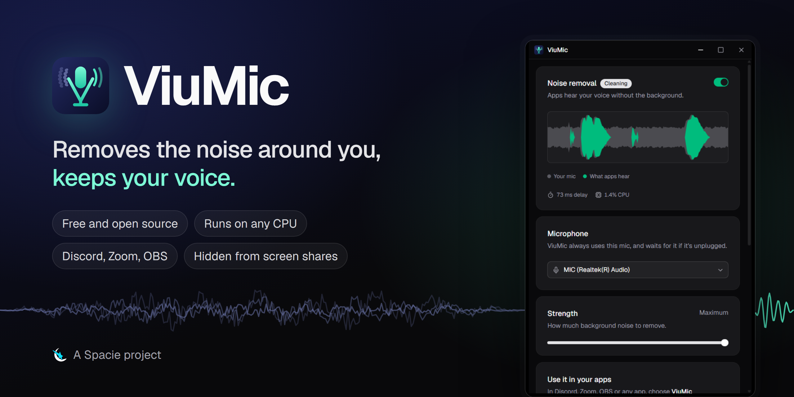
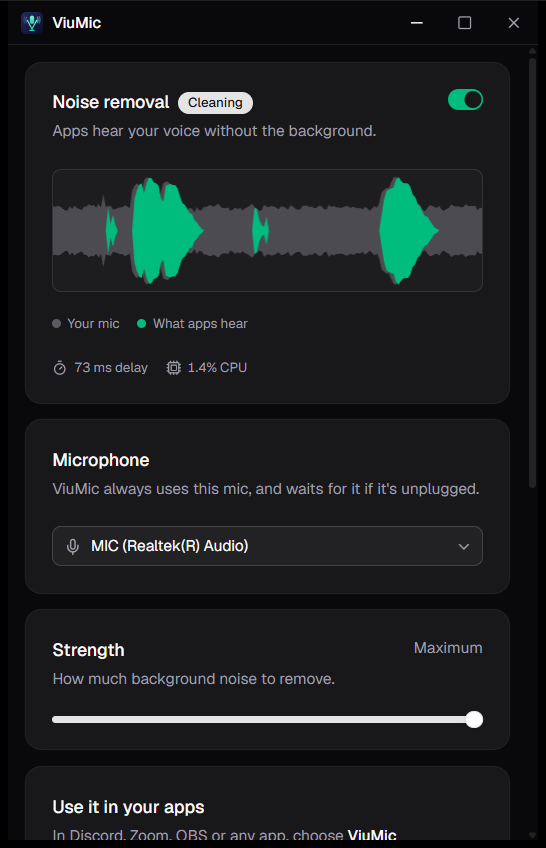
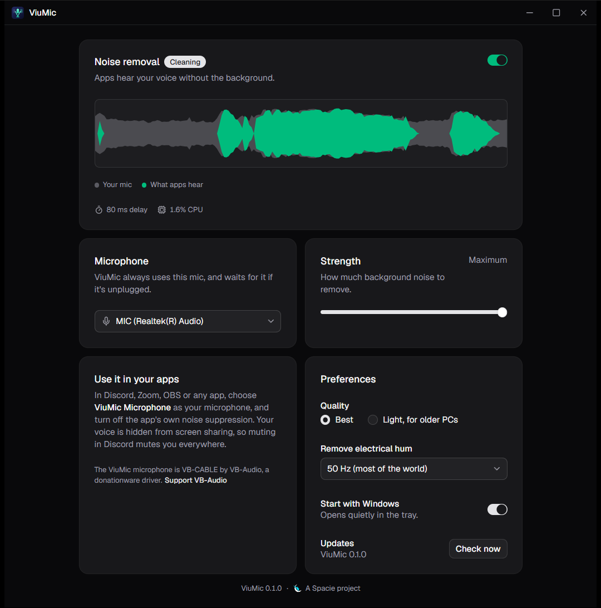
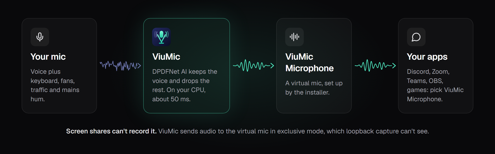

<p align="center">
  
</p>

<p align="center">
  <a href="https://github.com/abdvlrqhman/ViuMic/releases/latest"></a>
  <a href="https://github.com/abdvlrqhman/ViuMic/actions/workflows/ci.yml"></a>
  
  <a href="#license"></a>
</p>

<p align="center">
  <a href="https://spacie.net/"><picture><source media="(prefers-color-scheme: dark)" srcset="docs/spacie-mark.svg"></picture></a>
  A <a href="https://spacie.net/">Spacie</a> project
  ·
  <a href="https://github.com/abdvlrqhman/ViuMic/releases/latest">Download</a>
  ·
  <a href="PLAN.md">Roadmap</a>
</p>

ViuMic removes background noise from your microphone while you talk: keyboards, fans, traffic,
the TV next door, the electrical hum of a laptop mic. Discord, Zoom, Teams, OBS and every other
app get a clean **ViuMic Microphone**. It's free and open source, and it runs on the CPU, so it
doesn't need an RTX card. Under the hood is [DPDFNet](https://github.com/ceva-ip/DPDFNet), a
2026 speech-enhancement model, at full 48 kHz.

<table>
  <tr>
    <td width="38%"></td>
    <td width="62%"></td>
  </tr>
  <tr>
    <td align="center">Gray is your mic, green is what apps hear</td>
    <td align="center">Strength, quality and hum filter</td>
  </tr>
</table>

## What it does

- **Removes noise, keeps your voice.** DPDFNet separates speech from everything else in real
  time, with about 50 ms of processing delay. The strength slider lets a little room sound
  through, or takes all of it.
- **One clean mic for every app.** The installer adds a virtual microphone called
  ViuMic Microphone. Pick it once in each app; ViuMic remembers your real mic and waits for it
  when it's unplugged.
- **Private in screen shares.** Screen-share audio (Discord's "Entire screen", OBS desktop
  audio) records what every app *plays*. ViuMic plays your voice into its virtual mic in
  exclusive mode, which that capture can't see, so muting in Discord mutes you everywhere. It
  also follows Windows mute: the laptop mute key sends silence.
- **Light on your PC.** About 1.5% CPU on our test laptop. A **Light** quality option
  (RNNoise) is there for older PCs.
- **Stays out of the way.** It lives in the tray, can start with Windows, and updates itself
  from GitHub Releases. Updates are signature-checked and wait for your click, so nothing
  restarts mid-call.

## How it works

<p align="center">
  
</p>

## Install

1. Download `ViuMic_x.y.z_x64-setup.exe` from [Releases](https://github.com/abdvlrqhman/ViuMic/releases/latest)
   and run it. The installer isn't code-signed (that costs money, and ViuMic is free), so if
   Windows SmartScreen says "Windows protected your PC", choose **More info → Run anyway**.
2. The installer also sets up the virtual microphone ([VB-CABLE](https://vb-audio.com/Cable/)
   by VB-Audio, donationware). Windows asks once to trust its driver.
3. Open ViuMic and pick your microphone.
4. In Discord, Zoom or any app, choose **ViuMic Microphone** and turn off the app's own noise
   suppression (Krisp in Discord, for example).
5. Click **Make ViuMic the default** in ViuMic, so apps set to "Default" and your mute key use
   it too.

**Tip:** in Windows Settings → System → Sound → your mic, set **Audio enhancements** to
**Off**. Driver effects (common on Realtek laptop mics) pump the background noise up and down
with your voice, and no noise remover can undo that. Keep the input volume low enough that
loud speech doesn't clip.

Closing the window keeps ViuMic running in the tray. Quit is in the tray menu. Windows 10 and
11, 64-bit.

## CLI

`viumic-cli` (build it from source) runs the same engine without the app:

```
viumic-cli devices                          list mics and outputs
viumic-cli run --output "Headphones"        hear yourself instead of sending to the ViuMic microphone
viumic-cli run --model rnnoise              much lighter model, for weak CPUs
viumic-cli run --hum 60                     mains hum is 60 Hz where you live (the Americas)
viumic-cli denoise in.wav out.wav           offline, 48 kHz WAV
viumic-cli record raw.wav --seconds 20      raw mic sample, for bug reports
```

## Build from source

Requirements: Windows, Rust 1.95+, the MSVC build tools, Node 22+ and pnpm. The first build
needs network access: the `ort` crate downloads a prebuilt ONNX Runtime and links it
statically, so there's no DLL to ship.

```
pnpm install
pnpm dev                                  # the app with hot reload, as "ViuMic Dev"
pnpm build                                # installer in target/release/bundle/nsis/
cargo build --release -p viumic-cli       # just the CLI
```

The checks CI runs on every push:

```
pnpm --dir ui check
cargo fmt --all --check
cargo clippy --workspace --all-targets -- -D warnings
cargo test --workspace
```

Releases are built by GitHub Actions from version tags; see [docs/RELEASING.md](docs/RELEASING.md).

| Path | What |
|---|---|
| `crates/engine` | Audio engine: capture, DPDFNet and RNNoise, filters, limiter, exclusive-mode output. No UI. |
| `crates/cli` | `viumic-cli`. |
| `src-tauri` | Desktop app: window, tray, settings, device naming and defaults, updates. |
| `ui` | Svelte 5 + shadcn-svelte interface. |
| `models` | The embedded DPDFNet model and where it came from. |
| `vendor/vbcable` | VB-CABLE driver pack, shipped unmodified. |

## License

ViuMic is © 2026 Spacie, under [MIT](LICENSE-MIT) OR [Apache-2.0](LICENSE-APACHE), your
choice. Third-party parts keep their own licenses
([THIRD-PARTY-NOTICES.md](THIRD-PARTY-NOTICES.md)):

- **DPDFNet** model: Apache-2.0, © Ceva Inc., embedded in the binary. See [models/README.md](models/README.md).
- **VB-CABLE**: © Vincent Burel / VB-Audio, donationware, bundled unmodified. ViuMic's virtual
  mic exists thanks to their work: [support VB-Audio](https://vb-audio.com/Cable/).
- **ONNX Runtime** (MIT), **nnnoiseless/RNNoise** (BSD-3-Clause), **shadcn-svelte** (MIT).

## Built by Spacie

<a href="https://spacie.net/"><picture><source media="(prefers-color-scheme: dark)" srcset="docs/spacie-logo.png"></picture></a>

ViuMic is made by [Spacie](https://spacie.net/), the network of games and developer tools.
Bugs and ideas: [open an issue](https://github.com/abdvlrqhman/ViuMic/issues).
