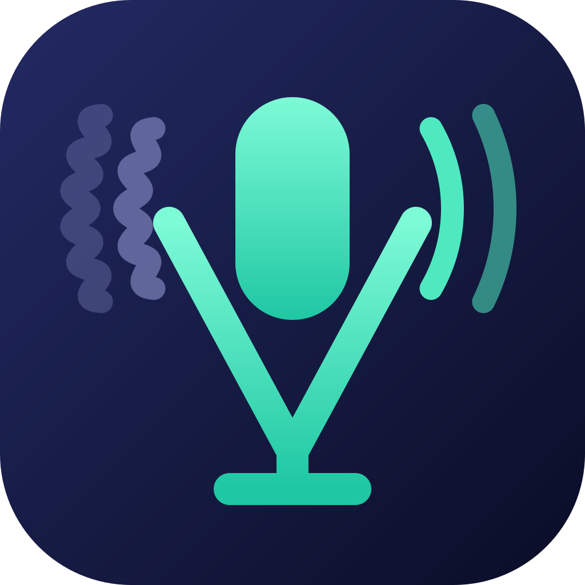

<p align="center"></p>

# ViuMic

Free, open-source AI noise removal for your microphone. It runs on the CPU (no RTX needed), using
[DPDFNet](https://github.com/ceva-ip/DPDFNet), a 2026 48 kHz speech-enhancement model.
Optionally, it can make your voice deeper.

Status: early. The engine and CLI work; the desktop app is next. See [PLAN.md](PLAN.md).

## Use it (CLI)

1. Install [VB-CABLE](https://vb-audio.com/Cable/). It's the free virtual cable ViuMic sends clean audio into. Installing it makes it your Windows default speaker and mic, so switch those back in Settings → Sound.
2. `viumic run`. It uses your default mic; if that's a virtual one (e.g. NVIDIA Broadcast), pass `--input "your mic"` (see `viumic devices`).
3. In Discord, Zoom or Teams, pick **CABLE Output** as your microphone, and turn off the app's own noise suppression.
4. Windows Settings → System → Sound → your mic → **Audio enhancements: Off**. Driver effects (common on Realtek laptop mics) pump the background noise up and down with your voice. ViuMic then hears a "wave" riding on your voice and can't undo it. Also keep the input volume low enough that loud speech doesn't clip.

```
viumic devices                          list mics and outputs
viumic run --output "Headphones"        hear yourself instead of sending to VB-CABLE
viumic run --model rnnoise              much lighter model, for weak CPUs
viumic run --hum 60                     mains hum is 60 Hz where you live (the Americas)
viumic run --deep 3                     voice 3 semitones deeper
viumic denoise in.wav out.wav           offline, 48 kHz WAV
viumic record raw.wav --seconds 20      raw mic sample, for bug reports
```

## Build

Requires Rust 1.95+, MSVC (Visual Studio Build Tools), LLVM (for the pitch-shifter bindings),
Node 22+ with pnpm (for the app), and network access on the first build (the `ort` crate downloads
a prebuilt ONNX Runtime and links it statically, so there's no DLL to ship):

```
winget install LLVM.LLVM
pnpm install
pnpm dev                  # desktop app with hot reload
pnpm build                # installer: target/release/bundle/nsis/
cargo build --release -p viumic-cli   # just the CLI
```

Layout: `crates/engine` (audio + models), `crates/cli`, `src-tauri` (desktop app backend),
`ui` (Svelte 5 frontend), `models` (embedded DPDFNet).

## License

MIT OR Apache-2.0. Third-party parts keep their own licenses:

- DPDFNet model (Apache-2.0, © Ceva Inc.), embedded in the binary; see [models/README.md](models/README.md)
- ONNX Runtime (MIT), nnnoiseless/RNNoise (BSD-3), Signalsmith Stretch (MIT)
